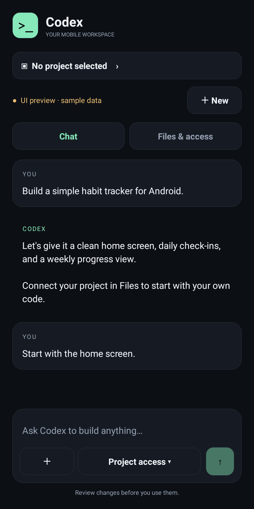
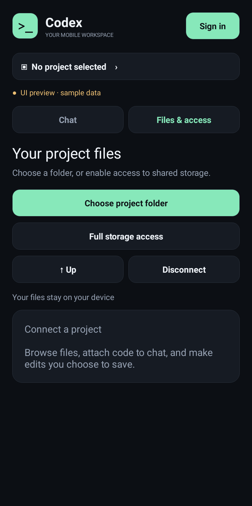

# Codex for Android — milestone 1

Native UI previews (sample data):

| Chat | Files and access |
| --- | --- |
|  |  |

Native Android client for ChatGPT sign-in and streamed Codex chat using a private
`codex app-server` child process over stdio. No Termux, visible terminal, remote
relay, or detached daemon. A temporary foreground notification keeps browser
sign-in alive and stops when the attempt finishes, is cancelled, or expires. This is an unofficial client.

## Current status

The redesigned native UI and file tools build successfully. The debug APK bundles
pinned upstream static-musl Codex executables for arm64 and x86_64.

**Login and live chat still need end-to-end device verification.** On Android 15, a shell
startup probe completed `initialize` and `account/read`. In the installed Android
9 app, the child connection closed during startup; this remains unresolved.
Android emulator system-service restarts also prevented reliable device testing.
That historical result does not establish compatibility of the updated runtime.
The user's Ubuntu/proot installation uses Codex 0.163.0 and completes login;
the first APK bundled 0.114.0. Version 0.1.1 matches 0.163.0 and now runs the
bundled `codex login` command directly. Its CLI-generated OAuth URL is forwarded
unchanged, preserving originator, state, PKCE, and the IPv4 loopback callback.
The custom app-server client identity no longer supplies the browser login URL.
After successful CLI exit, app-server restarts and verifies the saved account.
Arm64 devices, OAuth completion, model access, and Android sandbox policies remain
acceptance gates. This is a UI/file-access development prototype, not a completed
login-and-chat milestone.

Protocol reference: [Codex rust-v0.163.0 app-server](https://github.com/openai/codex/blob/rust-v0.163.0/codex-rs/app-server/README.md).
The client uses `initialize`/`initialized`, `account/read`, browser-based
`codex login` for browser authorization, app-local login completion/cancel,
logout, `thread/start`, and
`turn/start`, plus streamed agent messages and completion/error events.

## Build

Use JDK 17+, Android SDK platform 35, and Gradle 8.10.2 (or the included wrapper):

```sh
python3 scripts/fetch-runtime.py
./gradlew testDebugUnitTest assembleDebug
adb install -r app/build/outputs/apk/debug/app-debug.apk
```

Set `ANDROID_HOME` to your SDK location or create an untracked `local.properties`
with `sdk.dir=/absolute/path/to/android-sdk`.

## Bundled runtime

`python3 scripts/fetch-runtime.py` downloads Codex 0.163.0 from the official
`@openai/codex` npm package, verifies pinned SHA-256 hashes, and writes each
executable to `app/src/main/jniLibs/<abi>/libcodex.so`. The `.so` name is an Android
packaging convention; these are static PIE executables, not JNI libraries.
They do not require Android's bionic loader or a glibc installation. Native-library
extraction places them in Android's executable app installation directory.
The binaries are ignored by git and fetched explicitly in CI.

Static musl expects `/etc/resolv.conf`, absent on Android. An application-owned
loopback CONNECT bridge resolves official OpenAI hosts using Android's resolver.
It requires a random per-process proxy credential, accepts only OpenAI/ChatGPT
hosts on port 443, and forwards TLS bytes without decrypting traffic. Codex gets
this bridge through its proxy environment variables; `SSL_CERT_DIR` points to
Android's system CA directory. This helper is not a detached/background service.
It is closed when the runtime disconnects. The app-server itself uses only stdio.

This approach has a narrower compatibility claim than an Android-native port:
Android seccomp, filesystem layout, TLS, process execution, and Codex's Linux
sandbox assumptions still need device validation. An x86_64 startup probe is
not proof of arm64 device compatibility. Upstream LICENSE and NOTICE files are
included in APK assets. No arbitrary binary download or execution happens in
the installed app.

`CODEX_HOME`, `HOME`, workspace, and temporary files use app-private storage.
Backups are disabled. Codex owns OAuth tokens and refresh; the UI never reads or
logs tokens. This does not add hardware-backed encryption for Codex credential
files. Browser login relies on Codex's temporary IPv4 loopback OAuth callback listener
(separate from the stdio app-server transport). Verify the callback and process
survival while the browser is in front on target Android versions/OEMs.

## Files and permission modes

- **Project folder:** Android's Storage Access Framework grants access only to
  the chosen tree. The app retains the granted read/write flags, browses child
  folders, previews UTF-8 text files up to 128 KB, attaches their contents to chat,
  and can save explicitly confirmed edits. Disconnect releases the tree grant.
- **Full storage:** On Android 11+, the user can open the platform all-files
  settings screen, grant access, then browse shared external storage. Revocation
  also happens in Android Settings. Earlier Android versions use the folder
  picker. Other apps' private storage remains protected by Android.
- **Codex permissions:** The composer offers Read only, Project access, and Full
  access, mapped to `readOnly`, `workspaceWrite`, and `dangerFullAccess` in
  `thread/start`. Full access has a confirmation dialog. Changing mode starts a
  new conversation. Execution remains bounded by this Android app's permissions.
  These policies still require validation with a working Android runtime.
- The Codex workspace is app-private. SAF files are currently shared with Codex
  as text attachments, **not automatically mounted, mirrored, or synchronized**
  into that POSIX workspace. The Files editor can edit originals through Android's
  content provider. Direct agent editing of a selected SAF tree is future work.
- Server-initiated command/file approvals are currently declined; no interactive
  approval UI is implemented. Within-sandbox behavior depends on the chosen mode.

## Other behavior and limits

Sign-in opens the URL printed by the bundled `codex login` command and verifies
the saved account through a fresh app-server connection. Switching to the browser retains the application-owned
process, subject to Android process limits. The runtime status can be tapped to
retry a failed connection.

There is no conversation picker, restored transcript after activity/process
recreation, or explicit turn cancellation. Chat renders plain text. There is no
always-on background guarantee or root access.

## Device acceptance checks (pending runtime)

1. Cold launch; start sign-in, finish in browser, return to authenticated UI.
2. Cancel login and retry; reject/expire login and confirm visible failure.
3. Send two prompts; observe streaming and conversation continuity.
4. Try new chat, sign out, relaunch, and sign back in.
5. Test token refresh, offline failure, runtime exit, rotation, backgrounding,
   and OS process death. Ensure failure never appears as successful sign-in.
6. Validate each execution mode; confirm prompts cannot bypass its restrictions.
7. Pick a real SAF folder, relaunch, browse, attach a file, confirm an edit/save,
   disconnect, and verify permission revocation.
8. On Android 11+, grant and revoke all-files access in Settings and verify that
   shared-storage browsing follows that permission.

Local JVM tests exercise stdio response correlation, interleaved streaming,
approval refusal, RPC errors, pending-request failure on process exit, and
authenticated network tunnelling with host restrictions. Robolectric tests render
native views, check the composer fits, verify the Android folder-picker intent,
and check the three permission choices. Fourteen tests pass, including actual-runtime OAuth URL and account-handshake
smoke tests, cancellation, and the sign-in foreground notification. They do not substitute
for device tests of grants, provider writes, or live Codex access.

## Visual previews

Debug builds support explicitly labelled, disconnected sample screens. These are
for layout review only, not proof of successful authentication or model access:

```sh
adb shell am start -S -n dev.codex.android/.MainActivity --es preview login
adb shell am start -S -n dev.codex.android/.MainActivity --es preview chat
adb shell am start -S -n dev.codex.android/.MainActivity --es preview files
```

Normal launch without the extra always attempts the real runtime connection.
Release builds ignore the preview extra.

`previews/login-ui.png`, `chat-ui.png`, and `files-ui.png` are native Android view
renders generated by `UiPreviewTest` with sample chat data. They are not successful
OAuth/model-session screenshots. Run `./gradlew testDebugUnitTest` to regenerate.

## Login compatibility update (0.1.1)

The previous browser attempt was not equivalent to the user's working Termux
Ubuntu/proot setup: both Codex version and OAuth originator differed. The update
aligns the version and uses the CLI login path. No browser consent is bypassed,
no tokens are pasted into the app, and the authorize URL is neither modified nor
logged. A sign-in attempt expires after ten minutes; startup has a thirty-second
URL timeout. Cancellation destroys the login child process. A temporary visible
foreground service protects the session while the browser is in front.

Reaching the expected authorization URL in a test does not prove that the hosted
consent page, callback, token exchange, or authenticated chat works on Android.
Those steps still need a real account/device acceptance test. Full Linux sandbox
and optional helper/voice-resource support from the larger Codex package is not
claimed by this two-architecture chat prototype.

Development APKs are debug-signed by the build runner. If Android rejects an
update because the signatures differ, uninstall the earlier alpha first (this
removes its local app state), then install the new APK. Production signing and
stable upgrade signing are not configured yet.
